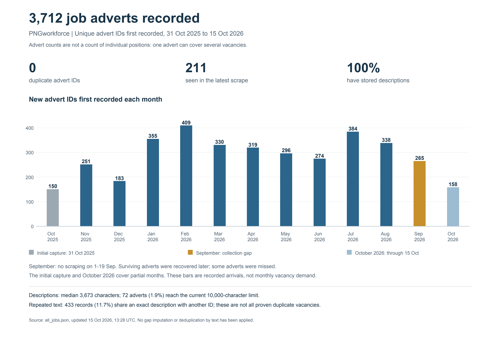

# PNGworkforce dataset summary — 15 October 2026

The consolidated dataset contains **3,712 distinct advert IDs**, updated at 2026-10-15T13:28:30.644436 UTC. 211 IDs were seen in the latest scrape. These are advert records, not a verified count of individual positions; one advert can cover multiple vacancies.

## Monthly counts

The main chart uses **the month an ID was first recorded by the scraper**. It does not count repeat observations of that ID. The first column below is therefore the appropriate definition of registrations. The second is a supplementary grouping by the latest stored advertised date, which may change when an advert is edited or re-advertised. All date normalization is in memory; source files are unchanged.

| Month | First recorded by scraper | Latest stored advertised date |
|---|---:|---:|
| Apr 2025 | — | 1 |
| Sep 2025 | — | 12 |
| Oct 2025 (initial capture on 31 Oct) | 150 | 155 |
| Nov 2025 | 251 | 213 |
| Dec 2025 | 183 | 174 |
| Jan 2026 | 355 | 324 |
| Feb 2026 | 409 | 412 |
| Mar 2026 | 330 | 345 |
| Apr 2026 | 319 | 321 |
| May 2026 | 296 | 280 |
| Jun 2026 | 274 | 288 |
| Jul 2026 | 384 | 380 |
| Aug 2026 | 338 | 342 |
| Sep 2026 (scrape interruption) | 265 | 286 |
| Oct 2026 (through 15 Oct) | 158 | 179 |
| **Total** | **3,712** | **3,712** |

October 2025 includes a stock of existing adverts captured at startup. October 2026 is partial. The 1–19 September 2026 interruption caused missing observations and later catch-up. Counts include captured survivors, with no adjustment for unobserved adverts. See the [September gap estimate](../../docs/SEPTEMBER_2026_GAP_ESTIMATE.md), which estimates about 75 missed IDs, with a 40–90 sensitivity range. That estimate is not an additional list of observed jobs and is not inserted into this chart.

## Duplicates and repeated advertising

- **0 duplicate ID rows**: all 3,712 records have different job IDs.
- **169 groups of exactly identical stored descriptions**, involving **433 records (11.7%)**. There are 264 records beyond one per identical-description group (7.1% of all records). This does not establish 264 duplicate vacancies.
- A stricter screen requiring the same employer, title, latest advertised date and description finds **49 groups involving 102 records** (53 beyond one per group). These remain candidates for review, not automatic deletions.
- Different IDs may represent reposts, parallel positions or separate recruitment rounds. Identical company templates and known title cuts also complicate matching. Near-duplicates with changed wording are not measured here.
- Repeated detail requests caused by URL aliases do not create repeated IDs in the final database.

The reviewable candidates are saved in [exact_description_repeat_groups.json](exact_description_repeat_groups.json). No records were merged or removed.

## Description coverage

- **3,712/3,712 records (100%) have nonempty descriptions**. The shortest stored description has 725 characters; the median is 3,673.
- Removing only the known trailing sharing controls for a length check leaves a median of 3,585.5 characters; 3,690/3,712 (99.4%) still have at least 1,000 characters. This is not a full semantic-cleaning or completeness test.
- **72 records (1.9%)** are exactly at the extractor's 10,000-character limit and are truncation candidates. Some current examples are confirmed truncated.
- 3,643 descriptions (98.1%) contain the site's sharing-form phrase. Most have substantive job text, but the stored text includes interface material. Some short on-site adverts link to fuller external descriptions.
- The full HTML archiver now preserves additional source text for later re-extraction where available. Historical field repair and classifier reruns have not been performed for this summary.

## Suggested wording for Silvia

“As of 15 October 2026, we have collected 3,712 distinct PNGworkforce job adverts over almost a year; 211 were visible in the latest scrape. All records have descriptions, typically around 3,700 characters. The database has no duplicate advert IDs, though some employers repost adverts, so advert counts should not be interpreted as a count of unique positions. The monthly chart shows first captures; October is partial and the September collection interruption means some adverts were missed.”

## Reproducibility

Source SHA-256: `7b0b330f6d999c29de5ddf3d6ce57e46e138944b5c871bb9d2f5c4f6314d5285`. Counts exclude 48 historical failure-list entries. All successful rows, including repeated-text candidates and long descriptions, remain in the denominator. The exact-description screen compares stored strings verbatim, without stemming, whitespace normalization or model-based matching.

Numeric results: [summary.json](summary.json). Reproduction: run `code/summarize_dataset.py` against this source snapshot using Python with ReportLab and pypdfium2. The scraper, production dataset and classifier are not modified.
